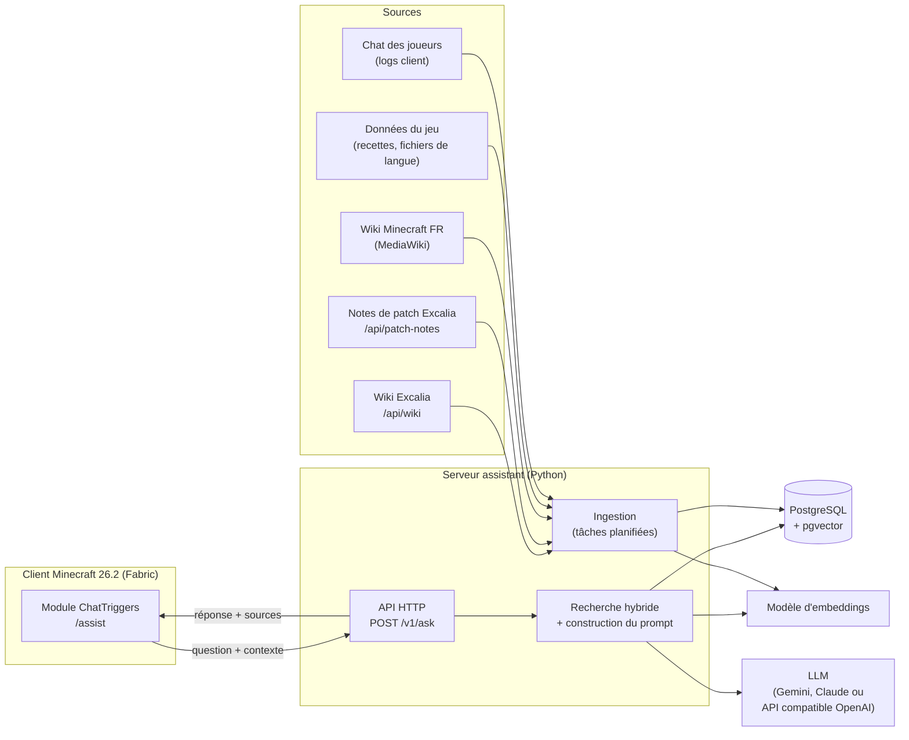

# Architecture

Assistant IA en jeu pour Minecraft : le joueur tape `/assist Comment craft un four ?`
et reçoit une réponse courte, sourcée, adaptée au serveur sur lequel il joue
(d'abord **Excalia — Skyblock saison 3**). Un même déploiement sert plusieurs serveurs :
le contenu Minecraft est commun, le contenu de chaque serveur lui est propre
([schema-donnees.md](schema-donnees.md#plusieurs-serveurs)).

## Vue d'ensemble



Deux chemins indépendants :

- **Chemin de requête** (temps réel, quelques secondes) : question → recherche → LLM → réponse.
- **Chemin d'ingestion** (hors ligne, planifié) : sources → découpage → embeddings → base.

Le client ne contient aucune logique métier : on peut changer de LLM, de base ou
de stratégie de recherche sans redistribuer le module.

## Composants

### Client : module ChatTriggers

- [ChatTriggers](https://modrinth.com/mod/ctjs) (`ctjs` **26.2v1**, bêta, Fabric) : modules
  écrits en JavaScript, rechargeables à chaud (`/ct load`), sans compiler de mod Java.
  Minecraft 26.2 demande **Java 25**.
- Rôle : enregistrer la commande `/assist`, envoyer la question **de façon asynchrone**
  (ne jamais bloquer le thread de rendu), afficher la réponse dans le chat local
  (jamais envoyée dans le chat public).
- Envoie avec la question : l'adresse du serveur, la version de Minecraft, la langue.
- Code dans [`client/assist/`](../client/assist/).

> ChatTriggers sait aussi écouter le chat (`register("chat", …)`). C'est une
> alternative à l'analyse des fichiers de logs pour récolter les questions des joueurs
> (voir [plan de développement](plan-developpement.md), phase 4).

### Serveur : API HTTP

- Python (même langage que l'ingestion), framework web léger (FastAPI envisagé).
- Une route principale, `POST /v1/ask` (contrat plus bas), plus `POST /v1/feedback`
  pour les retours 👍/👎.
- Authentification par jeton par joueur et limite de débit : sans ça, n'importe qui
  possédant le module peut consommer le budget LLM.
- Code dans [`server/api/`](../server/api/).

### Serveur : ingestion

Une tâche par source, toutes avec le même principe : récupérer → découper en chunks
→ calculer les embeddings des seuls chunks nouveaux ou modifiés → écrire en base.

| Source | Méthode | État |
|---|---|---|
| Wiki Excalia | `GET https://excalia.fr/api/wiki` (tout le wiki en un appel), découpage par section | ✅ [`excalia_wiki.py`](../server/ingestion/excalia_wiki.py) |
| Notes de patch Excalia | `GET /api/patch-notes?take=20` + sitemap pour la liste, `GET /api/patch-notes/<slug>` pour le détail ; découpage par section, date dans chaque chunk | ✅ [`excalia_patch_notes.py`](../server/ingestion/excalia_patch_notes.py) |
| Wiki Minecraft FR | API MediaWiki (`action=parse`) ou dumps XML | à faire |
| Données du jeu | Recettes JSON et `fr_fr.json` extraits du jar client 26.2 | à faire |
| Chat des joueurs | Logs client (`logs/latest.log`, `*.log.gz`) ou capture ChatTriggers, puis système de confiance ([confiance-chat.md](confiance-chat.md)) | calcul de confiance ✅ [`trust.py`](../server/qa/trust.py), collecte à faire |

Chaque serveur est décrit dans [`server/config/servers.toml`](../server/config/servers.toml)
(adresses, version, saison, sources, rôles du chat) ; les scripts prennent `--server <slug>`.
Le découpage HTML est partagé ([`html_chunker.py`](../server/ingestion/html_chunker.py)).
Code dans [`server/ingestion/`](../server/ingestion/), données produites dans
`server/data/common/` et `server/data/servers/<slug>/` (non versionnées).

### Base de données

PostgreSQL + `pgvector` + `unaccent` : recherche vectorielle, plein texte français,
données relationnelles et filtres dans une seule requête SQL. Détail dans
[schema-donnees.md](schema-donnees.md).

### LLM

- **Fournisseur au choix** (`ASSIST_LLM`), derrière une même interface
  ([`api/llm.py`](../server/api/llm.py), un fichier par fournisseur dans
  [`api/providers/`](../server/api/providers/)) : même prompt, même format de réponse,
  mêmes erreurs (refus → réponse polie, panne ou quota → 503).
- **Par défaut : Gemini** (`gemini-3.5-flash-lite`), utilisable gratuitement dans les
  quotas du palier gratuit de l'API Gemini. L'API Claude est facturée à l'usage, en plus
  d'un abonnement Claude Pro.
- **Claude** (`claude-opus-5-5`) : effort `low`, repli serveur en cas de refus
  (`fallbacks: "default"`), `stop_reason` vérifié avant de lire la réponse.
- **Toute API compatible OpenAI** : Ollama en local (gratuit, sans quota), Mistral, Groq…
- Les réponses sont courtes et le contexte est fourni par le RAG : la réflexion est
  réglée au plus bas (`ASSIST_EFFORT=low`), à remonter seulement si l'évaluation le
  justifie. Le choix du modèle se tranche **après mesure** sur le jeu d'évaluation
  (phase 2).
- Prompt système stable ; le contexte RAG et la question viennent après (ce qui
  permet la mise en cache du prompt chez les fournisseurs qui la proposent).
- Le modèle d'embeddings est choisi à part (multilingue, bon en français ; par exemple
  `bge-m3` en local, 1024 dimensions, ou les embeddings de l'API Gemini). Choix à confirmer.
- Sur le palier gratuit de Gemini, Google peut utiliser les questions pour améliorer
  ses produits : à mentionner aux joueurs si le module est diffusé.

## Flux d'une question

1. Le joueur tape `/assist Comment fabriquer un four nucléaire ?`.
2. Le module envoie `POST /v1/ask` avec la question, le serveur (`play.excalia.fr`)
   et la version. L'API retrouve le serveur par son adresse : la suite ne porte que
   sur le contenu commun et celui de ce serveur (saison en cours).
3. Le serveur vérifie le jeton et la limite de débit, puis cherche dans le **cache
   sémantique** une question très proche déjà répondue.
4. **Détection d'entités** : les mots de la question sont comparés aux alias d'items
   (`four` → `minecraft:furnace`). Si un item est reconnu, ses recettes exactes sont
   lues en base (recette serveur prioritaire sur la vanilla, recettes désactivées exclues).
5. **Recherche hybride** dans les chunks : vecteurs + plein texte, fusion RRF,
   filtres serveur/version/expiration, pondération par priorité de source.
6. **Prompt** : consignes (répondre uniquement à partir du contexte, sinon dire qu'on
   ne sait pas, citer la source, 2 à 4 phrases), puis recettes, puis chunks triés.
7. Appel au LLM, réponse renvoyée au client avec ses sources.
8. Journalisation dans `queries` (question, chunks utilisés, réponse, latence).

### Priorité des sources

Le serveur peut modifier le jeu vanilla (recettes custom, items désactivés). Ordre
appliqué au classement et rappelé au LLM dans le prompt :

**wiki du serveur > notes de patch du serveur > données du jeu > wiki Minecraft > faits du chat**

Entre une page de wiki et une note de patch plus récente qui la contredit, le prompt
fait préférer l'information datée la plus récente. Les faits du chat sont présentés
comme venant des joueurs (« d'après les joueurs… »).

## Contrat de l'API

### `POST /v1/ask`

Requête :

```json
{
  "question": "Comment fabriquer un four nucléaire ?",
  "server": "play.excalia.fr",
  "mc_version": "26.2",
  "lang": "fr"
}
```

En-tête : `Authorization: Bearer <jeton du joueur>`.

Réponse `200` :

```json
{
  "answer": "Le four nucléaire se fabrique dans /ccraft : 8 lingots de cuivre ★ autour d'un four (1 206 $).",
  "sources": [
    {"title": "Les autres machines › Four nucléaire",
     "url": "https://excalia.fr/wiki/s3-machines-energie/les-autres-machines#sec-four-nucleaire"}
  ],
  "query_id": "57454e81d01b",
  "cached": false
}
```

En phase 1, `sources` est toujours vide : il sera rempli par le RAG (phase 2).

Erreurs, toutes au format `{"error": "…"}` : `401` (jeton manquant ou invalide),
`422` (question vide ou de plus de 256 caractères), `429` (limite atteinte, en-tête
`Retry-After`), `503` (LLM indisponible). Le client affiche un message court dans tous
les cas.

### `GET /v1/health`

`{"status": "ok"}` : vérifie que l'API tourne.

### `POST /v1/feedback`

`{"query_id": "57454e81d01b", "vote": 1}` (`1` ou `-1`), déclenché par `/assist bien` ou
`/assist faux`. Prévu en phase 5, pas encore implémenté.

## Sécurité et vie privée

- Le jeton du joueur et la clé API du LLM ne transitent jamais dans le chat.
  La clé LLM reste côté serveur, dans `server/.env`, ignoré par git.
- Les pseudos issus du chat sont **pseudonymisés** (HMAC) avant stockage.
  Aucun message brut ne sert de source : seuls les faits qui passent le système de
  confiance ([confiance-chat.md](confiance-chat.md)) sont utilisés.
- Les données du wiki et des notes de patch d'Excalia appartiennent à Excalia : on les utilise pour cet
  assistant avec l'accord de l'équipe (la route `/api/` est exclue par leur
  `robots.txt`, elle nous a été communiquée).
- Le wiki Minecraft est sous licence CC BY-NC-SA : on cite la source et on reste
  dans un usage non commercial.

## Choix techniques

| Sujet | Choix | Pourquoi |
|---|---|---|
| Client | Module ChatTriggers | JavaScript, rechargement à chaud, pas de build Java ; build `26.2v1` disponible pour la version du serveur |
| Serveur | Python | Même langage que l'ingestion ; écosystème RAG et SDK des fournisseurs de LLM |
| Base | PostgreSQL + pgvector | Une seule base pour vecteurs, plein texte, relationnel et filtres ; volume modeste (quelques dizaines de milliers de chunks) |
| Recherche | Hybride (vecteurs + BM25/tsvector, fusion RRF) | Le vocabulaire Minecraft est très lexical (noms d'items, commandes) |
| Recettes | Table structurée, pas de texte | Réponses exactes et propres à chaque version |
| LLM | Gemini par défaut (gratuit), Claude ou API compatible OpenAI au choix | Pas de coût imposé ; changer de fournisseur ne demande qu'une ligne dans `server/.env` |
| Multi-serveur | Une base, `server_id NULL` = commun | Le contenu Minecraft n'est stocké qu'une fois ; chaque serveur garde son contenu, son chat et ses rôles |
| Chat | Confiance calculée, sans validation obligatoire | Rôle de l'auteur, réputation apprise, nombre d'auteurs distincts, vérification par les sources officielles |

## Points ouverts

- ~~**Launcher Excalia**~~ : réglé. Il utilise Fabric par défaut et accepte
  ChatTriggers directement. Le build `26.2v1` de ChatTriggers reste une bêta.
- ~~**Règlement Excalia**~~ : réglé. Le module est validé par le staff.
- **Version de Minecraft** : le serveur est en **26.2** (« Chaos Cubed », 16/06/2026).
  À surveiller : 26.3 est déjà sortie, il faudra suivre les montées de version
  du serveur (build ChatTriggers, recettes, fichiers de langue).
- **Modèle d'embeddings** : local (`bge-m3`) ou via une API.
- **Hébergement** du serveur assistant.
