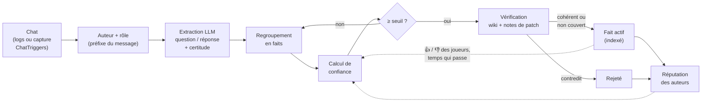
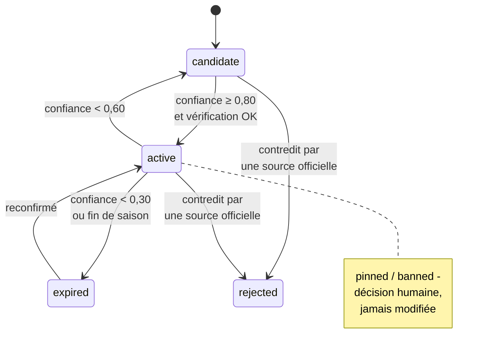

# Apprentissage depuis le chat et système de confiance

Les joueurs se répondent en permanence dans le chat. L'objectif est d'en tirer des
connaissances **sans validation humaine obligatoire** : le système décide seul de ce
qu'il croit, à partir de **qui** a répondu et de **combien de fois** la même réponse
revient. Une intervention humaine reste possible, mais seulement pour corriger le
système (forcer, bannir), jamais pour le faire fonctionner.

Implémentation du calcul : [`server/qa/trust.py`](../server/qa/trust.py), avec ses
scénarios testés dans [`test_trust.py`](../server/qa/test_trust.py). Les tables sont
décrites dans [schema-donnees.md](schema-donnees.md#chat-et-confiance).

## Vue d'ensemble



Une **tâche de maintenance** (toutes les heures, par exemple) recalcule la confiance
des faits touchés depuis le dernier passage, puis applique les changements de statut.

## 1. Qui parle : rôles et confiance de base

Chaque serveur déclare ses rôles et leur confiance de base dans
[`servers.toml`](../server/config/servers.toml) :

| Rôle | Confiance de base | Détection |
|---|---|---|
| `admin` | 0,95 | préfixe du message, ex. `[Admin]` |
| `moderateur` | 0,90 | ex. `[Modo]` |
| `guide` | 0,85 | ex. `[Guide]` |
| `joueur` | 0,30 | par défaut |

- Le rôle est lu dans le **préfixe de grade** de chaque message, avec les expressions
  régulières de `[<serveur>.chat.role_prefixes]`. Le format exact des préfixes
  d'Excalia reste à relever sur de vrais logs.
- Un rôle peut être **forcé à la main** (`role_source = 'manual'`), par exemple pour
  un joueur reconnu comme expert. Un rôle manuel n'est jamais écrasé par le préfixe.
- Un auteur peut être **banni** (troll) : sa confiance tombe à 0.

## 2. Réputation apprise

La confiance d'un auteur part de celle de son rôle, puis évolue avec son historique :
chaque fois qu'un fait est tranché, ceux qui avaient donné la bonne réponse gagnent
un point `confirmed`, les autres un point `contradicted`.

```
confiance = (rôle × 4 + confirmed) / (4 + confirmed + contradicted)     (plafond 0,95)
```

Le rôle compte comme 4 réponses. Il pèse donc beaucoup au début, puis l'historique
prend le dessus :

| Auteur | Confiance |
|---|---|
| Joueur, sans historique | 0,30 |
| Joueur confirmé 8 fois | 0,77 |
| Guide contredit 6 fois | 0,34 |

Un joueur fiable devient presque un guide. Un guide qui se trompe souvent perd sa
crédibilité, sans intervention humaine.

## 3. Confiance d'un fait

Un **fait** est une question canonique accompagnée d'**une** réponse canonique. Chaque
fois qu'un auteur donne cette réponse (ou la contredit), on enregistre une occurrence
(`qa_claims`), avec la certitude du LLM qui l'a extraite du chat.

1. **Poids d'une occurrence** = confiance de l'auteur × certitude de l'extraction.
2. **Une voix par auteur et par position** : répéter la même réponse 20 fois ne
   compte qu'une fois.
3. **Cumul des voix** en « au moins un a raison » (noisy-OR) :
   `soutien = 1 − Π(1 − poids)`, et de même pour les contradictions.
4. **Retours des joueurs** : chaque 👍 ou 👎 sur une réponse de `/assist` qui a utilisé
   ce fait compte comme une voix de poids 0,15.
5. **Confiance** = `soutien × (1 − contradiction)`.
6. **Usure du temps** : la confiance est divisée par 2 tous les 60 jours sans nouvelle
   confirmation dans le chat. Une information qui n'est plus répétée finit par expirer.

### Concurrence entre réponses

Plusieurs faits peuvent répondre à la même question (`question_group`), avec des
réponses différentes. Un concurrent ne pénalise un fait que s'il atteint **au moins
la moitié** de sa confiance :

```
confiance finale = confiance × (1 − max(0, meilleur concurrent − confiance / 2))
```

Un joueur isolé ne fait pas tomber la réponse d'un modérateur. En revanche, deux
réponses de force comparable restent toutes les deux « contestées » jusqu'à ce que
l'une prenne le dessus.

## 4. Statuts et seuils



- Il faut **0,80** pour devenir actif, et un fait actif ne redescend qu'**en dessous
  de 0,60**. Cet écart (hystérésis) évite qu'un fait clignote autour du seuil.
- Un fait actif est indexé comme un document de source `chat_qa`, avec une priorité
  basse (10). La réponse de `/assist` le présente comme venant des joueurs
  (« d'après les joueurs… »).

### Vérification par les sources officielles

Avant d'activer un fait, le LLM le compare aux chunks les plus proches du wiki et des
notes de patch du serveur, puis classe le résultat :

| Résultat | Effet |
|---|---|
| `consistent` | Activé : le chat confirme le wiki. Utile pour reformuler une question mal posée. |
| `not_covered` | Activé : c'est le cas le plus utile, une information que le wiki n'a pas. |
| `contradicts` | Rejeté : la source officielle l'emporte. Les auteurs sont marqués `contradicted`. |

Quand une **nouvelle note de patch** est publiée, les faits actifs proches de son
contenu repassent en `unchecked` et sont revérifiés. Par exemple, un fait « le
réservoir d'oxygène I tient 5 min » est rejeté après le patch 3.6, qui le passe
à 15 min.

### Saisons

Chaque fait porte la saison du serveur au moment de sa collecte. Au changement de
saison, les faits de l'ancienne saison expirent.

## 5. Scénarios

Calculés avec les paramètres par défaut et une certitude d'extraction de 0,9 (voir
`test_trust.py`).

| Situation | Confiance | Statut |
|---|---|---|
| 1 modérateur | 0,81 | **actif** (après vérification) |
| 1 guide | 0,77 | candidat |
| 1 guide + 1 joueur | 0,83 | **actif** |
| 1 joueur | 0,27 | candidat |
| 1 joueur qui répète 20 fois | 0,27 | candidat |
| 4 joueurs différents | 0,72 | candidat |
| 5 joueurs différents | 0,79 | candidat |
| 6 joueurs différents | 0,85 | **actif** |
| 6 joueurs, contredits par 1 modérateur | 0,16 | candidat |
| 1 modérateur, puis 3 👎 sur `/assist` | 0,50 | redescend en candidat |
| Modérateur (0,81) contre 1 joueur (0,27) | 0,81 contre 0,09 | le modérateur l'emporte |
| 6 joueurs (0,85) contre 5 joueurs (0,79) | 0,54 contre 0,43 | les deux restent contestés |

## 6. Garde-fous

- **Messages privés exclus** de la collecte : on ne garde que les canaux publics.
- **Une voix par auteur** : le spam ne fait pas monter un fait.
- **Joueurs à faible confiance par défaut** : il faut six joueurs différents qui
  disent la même chose, sans contradiction, pour qu'une réponse passe sans
  intervention d'un membre de l'équipe.
- **Priorité basse** : un fait du chat ne passe jamais devant le wiki ou les notes
  de patch dans la recherche.
- **Expiration** : rien ne reste actif indéfiniment sans être reconfirmé.
- **Vie privée** : les pseudos ne sont jamais stockés en clair.
  `author_hash = HMAC-SHA256(secret, "<serveur>:<pseudo en minuscules>")`. Le secret
  reste sur le serveur assistant. Pour forcer un rôle ou bannir un joueur, l'outil
  d'administration recalcule le hash à partir du pseudo saisi.

## 7. Interventions humaines (facultatives)

Le système fonctionne sans elles. Elles servent seulement à corriger :

| Action | Effet |
|---|---|
| Épingler un fait | `pinned` : toujours actif, quelle que soit sa confiance |
| Bannir un fait | `banned` : jamais actif |
| Forcer le rôle d'un joueur | `role_source = 'manual'` |
| Bannir un auteur | confiance 0, ses occurrences ne comptent plus |

## 8. Paramètres

Définis en tête de [`trust.py`](../server/qa/trust.py). Ils sont à ajuster sur des
données réelles, en phase 4.

| Paramètre | Valeur | Rôle |
|---|---|---|
| `PRIOR_STRENGTH` | 4 | Nombre de réponses « équivalent » au rôle |
| `MAX_TRUST` | 0,95 | Plafond de confiance d'un auteur |
| `FEEDBACK_WEIGHT` | 0,15 | Poids d'un 👍 / 👎 |
| `HALF_LIFE_DAYS` | 60 | Demi-vie sans confirmation |
| `ACTIVATE_AT` | 0,80 | Seuil d'activation |
| `DEACTIVATE_AT` | 0,60 | Seuil de désactivation (hystérésis) |
| `EXPIRE_AT` | 0,30 | Seuil d'expiration |
