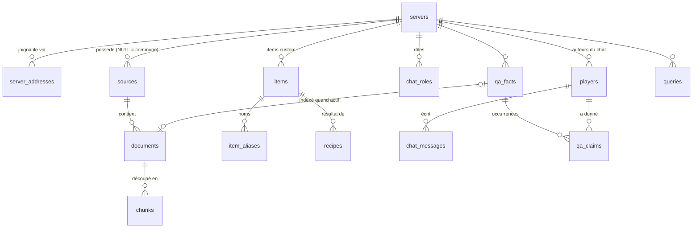

# Schéma de données

Base **PostgreSQL 16+** avec les extensions **pgvector** (0.8+) et **unaccent**.
Le script de création est [`server/db/schema.sql`](../server/db/schema.sql).

## Pourquoi PostgreSQL et pas une base vectorielle dédiée

- Une seule base pour les vecteurs (`pgvector`, index HNSW), le plein texte français
  (`tsvector`), les données relationnelles (recettes, items, rôles) et les métadonnées
  (`jsonb`).
- Les filtres (serveur, saison, version, expiration) et la recherche tiennent dans
  **une seule requête SQL**, sans synchroniser deux bases.
- Le volume reste modeste : environ 950 chunks pour Excalia saison 3 (wiki + notes de
  patch), quelques dizaines de milliers avec le wiki Minecraft.

## Plusieurs serveurs

Le système sert plusieurs serveurs Minecraft avec une seule base et un seul
déploiement. Une seule règle s'applique partout :

> **`server_id NULL` = donnée commune à tous les serveurs. `server_id` renseigné =
> donnée propre à ce serveur.**

| Donnée | Portée | Exemple |
|---|---|---|
| Wiki Minecraft, données du jeu (recettes, langues) | **commune** (filtrée par version de Minecraft) | recette du four en 26.2 |
| Wiki et notes de patch du serveur | **un serveur** (et une saison) | four nucléaire d'Excalia |
| Recettes modifiées ou désactivées, items custom, argot | **un serveur**, prioritaire sur le commun | `comp` = compacté sur Excalia |
| Chat, rôles, réputation des joueurs, faits | **un serveur** | un modérateur d'Excalia n'a aucun poids sur un autre serveur |
| Requêtes `/assist` | **un serveur** | statistiques par serveur |

À chaque question, l'API retrouve le serveur grâce à l'adresse envoyée par le client
(`server_addresses`). La recherche porte alors sur le contenu commun **plus** le
contenu de ce serveur, et jamais sur celui des autres serveurs.

Ajouter un serveur demande trois choses :

1. une section dans [`servers.toml`](../server/config/servers.toml) : adresses,
   version de Minecraft, saison, sources, rôles du chat ;
2. un script d'ingestion pour chacune de ses sources, s'il n'en existe pas déjà un
   pour ce type de site ;
3. le chargement en base, qui crée les lignes `servers`, `server_addresses`,
   `sources` et `chat_roles` à partir de la configuration.

### Rangement des fichiers produits

```
server/data/
├── common/                         partagé par tous les serveurs
│   └── minecraft/<version>/          wiki Minecraft, recettes, langues (phase 3)
└── servers/
    └── excalia/
        ├── wiki/                     chunks.jsonl, state.json, wiki_raw.json
        └── patch_notes/              chunks.jsonl, state.json, raw/<slug>.json
```

## Vue d'ensemble



Le schéma sépare trois familles de données :

1. **Texte libre** (`sources` → `documents` → `chunks`) : wikis, notes de patch et faits
   actifs du chat, interrogés par recherche hybride.
2. **Données structurées** (`items`, `item_aliases`, `recipes`) : interrogées
   directement. On ne cherche pas une recette comme un paragraphe.
3. **Chat et exploitation** (`chat_roles`, `players`, `chat_messages`, `qa_facts`,
   `qa_claims`, `queries`) : récolte du chat, système de confiance, journal, cache et
   retours des joueurs.

## Tables

### Référentiels

| Table | Rôle |
|---|---|
| `mc_versions` | Versions de Minecraft, identifiées par leur *data version* entière, ce qui rend les comparaisons simples. |
| `servers` | Un serveur pris en charge (`slug` = clé de `servers.toml`), sa version de Minecraft et sa **saison en cours**. |
| `server_addresses` | Les adresses (`play.excalia.fr`, `excalia.fr`…) qui désignent un serveur. |

### Texte libre

| Table | Rôle |
|---|---|
| `sources` | Une source d'ingestion : type (`server_wiki`, `server_news`, `game_data`, `official_wiki`, `chat_qa`), serveur (NULL = commune), clé de configuration, **saison**, **priorité**, langue. |
| `documents` | Une page ou une note de patch : URL, titre, catégorie, `content_hash` (ne recalculer que ce qui change), `published_at` (la source datée la plus récente l'emporte), `expires_at` (faits du chat). |
| `chunks` | Une section de page : `heading_path`, contenu, plage de versions, confiance, embedding, `tsvector` généré. `chunk_key` est l'identifiant stable produit par l'ingestion. |

Priorités par défaut : wiki du serveur 100, notes de patch 90, données du jeu 70,
wiki Minecraft 50, faits du chat 10.

**Notes de patch et wiki** : une note de patch récente peut contredire une page de
wiki pas encore mise à jour. Chaque chunk de note porte sa date (dans `published_at`
et dans le texte embeddé : « Patch 3.6 (01/11/2026) > 4. Oxygène »). Le prompt
demande au LLM de préférer l'information datée la plus récente en cas de conflit.

Choix notables pour `chunks` :

- **`heading_path`** est préfixé au texte embeddé (« Les cannes (12) > Chiffres »).
  Ainsi, un chunk qui ne contient qu'un tableau sait de quoi il parle.
- **Le `tsvector`** donne un poids `A` aux titres et `B` au contenu, avec la configuration
  `french` et sans accents (`f_unaccent`). « teleporter » trouve donc « téléporter ».
- **`versions`** (`int4range`) se filtre avec `versions @> <data version> OR versions IS NULL`.
  La data version de 26.2 se lit dans le `version.json` du jar client (champ `world_version`).
- **`embed_model`** permet de changer de modèle d'embeddings et de réindexer
  progressivement.
- **La dimension `vector(1024)`** dépend du modèle d'embeddings, à confirmer (1024 pour `bge-m3`).

### Données structurées

| Table | Rôle |
|---|---|
| `items` | Identifiants d'items, vanilla (`minecraft:furnace`) ou propres à un serveur. |
| `item_aliases` | Noms en langage naturel par langue (`four`, `fourneau`, `furnace`). Communs (depuis `fr_fr.json` / `en_us.json`) ou propres à un serveur (argot). |
| `recipes` | Recettes exactes : type, grille (`jsonb`), versions, serveur. `disabled` masque une recette vanilla retirée par le serveur. |

Pour Excalia, les recettes custom (table `/ccraft` 6×6, ressources compactées ★,
machines) ne sont décrites que dans le wiki et les notes de patch. Elles commencent
donc comme du texte dans `chunks`. On les structurera dans `recipes` seulement si
l'usage le justifie.

### Chat et confiance

Fonctionnement détaillé : [confiance-chat.md](confiance-chat.md).

| Table | Rôle |
|---|---|
| `chat_roles` | Confiance de base de chaque rôle, par serveur (admin 0,95, modérateur 0,9, guide 0,85, joueur 0,3). |
| `players` | Un auteur du chat sur un serveur, identifié par le **HMAC de son pseudo** : rôle (lu dans le préfixe, ou forcé à la main), réputation apprise (`confirmed` / `contradicted`), bannissement. |
| `chat_messages` | Messages publics bruts, avec le rôle de l'auteur au moment du message. Ils ne servent jamais directement de source de réponse. |
| `qa_facts` | Un fait : question canonique et **une** réponse canonique. Contient la confiance calculée, le résultat de la vérification officielle et un statut (`candidate`, `active`, `rejected`, `expired`, `pinned`, `banned`). Les faits qui répondent à la même question partagent un `question_group`. |
| `qa_claims` | Une occurrence : tel auteur a donné (`stance = 1`) ou contredit (`-1`) tel fait, avec la certitude du LLM qui l'a extraite. |

Un fait qui passe `active` devient un `document` de source `chat_qa`, et donc des
chunks recherchables. Quand il redescend, ce document est supprimé.

### Journal

| Table | Rôle |
|---|---|
| `queries` | Journal de chaque question : contexte fourni (chunks, recettes, **faits du chat**), modèle, latence, retour du joueur. Sert de **cache sémantique** (via `q_embedding`), de débogage et de repérage des trous du wiki. Un 👎 pénalise les faits utilisés (`fact_ids`). |

## De l'ingestion à la base

Les scripts d'ingestion produisent un `chunks.jsonl` par source. Le chargeur (phase 2)
fera la correspondance suivante :

| Champ JSONL | Destination |
|---|---|
| `server`, `source` | `servers.slug`, puis `sources.config_key` (`wiki` → `server_wiki`, `patch_notes` → `server_news`) |
| `wiki` (`saison3`), ou la saison du serveur | `sources.season` |
| URL sans ancre, `title`, `category_name` ou `version` | `documents.url`, `.title`, `.category` |
| `published_at` (notes de patch) | `documents.published_at` |
| hash de la page (`state.json`) | `documents.content_hash` |
| `id` | `chunks.chunk_key` |
| `url` (avec ancre) | `chunks.url` |
| `heading_path`, `content` | `chunks.heading_path`, `.content` |
| `embed_text` | entrée du modèle d'embeddings, dont le résultat va dans `chunks.embedding` |

Une page dont le hash n'a pas changé est ignorée. Une page modifiée voit ses chunks
supprimés puis recréés. Une page disparue de la source est supprimée, avec ses
chunks (`ON DELETE CASCADE`).

## Requête de recherche hybride

On fait une recherche vectorielle et une recherche plein texte, on les fusionne par
*Reciprocal Rank Fusion*, puis on pondère par la priorité de la source et la confiance
du chunk. Le filtre garde le contenu commun et celui du serveur, pour sa saison en
cours.

```sql
-- $1 : embedding de la question, $2 : texte de la question,
-- $3 : data version du client, $4 : id du serveur
WITH srv AS (
  SELECT id, season FROM servers WHERE id = $4
),
eligible AS (
  SELECT c.id, c.embedding, c.tsv, c.confidence, s.priority
  FROM chunks c
  JOIN documents d ON d.id = c.document_id
  JOIN sources   s ON s.id = d.source_id
  CROSS JOIN srv
  WHERE s.active
    AND (s.server_id IS NULL OR s.server_id = srv.id)
    AND (s.season IS NULL OR s.season = srv.season)
    AND (c.versions IS NULL OR c.versions @> $3::int)
    AND (d.expires_at IS NULL OR d.expires_at > now())
),
vec AS (
  SELECT id, row_number() OVER (ORDER BY embedding <=> $1) AS r
  FROM eligible ORDER BY embedding <=> $1 LIMIT 40
),
fts AS (
  SELECT id, row_number() OVER (ORDER BY ts_rank_cd(tsv, q) DESC) AS r
  FROM eligible, websearch_to_tsquery('french', f_unaccent($2)) AS q
  WHERE tsv @@ q
  ORDER BY ts_rank_cd(tsv, q) DESC LIMIT 40
)
SELECT e.id,
       (COALESCE(1.0 / (60 + v.r), 0) + COALESCE(1.0 / (60 + f.r), 0))
         * (1 + e.priority / 100.0) * e.confidence AS score
FROM eligible e
LEFT JOIN vec v USING (id)
LEFT JOIN fts f USING (id)
WHERE v.id IS NOT NULL OR f.id IS NOT NULL
ORDER BY score DESC
LIMIT 8;
```

Avec des filtres `WHERE`, l'index HNSW peut renvoyer moins de résultats que la limite
demandée. Depuis pgvector 0.8, `SET hnsw.iterative_scan = relaxed_order;` corrige ce
problème.

## Volumétrie attendue

| Donnée | Ordre de grandeur |
|---|---|
| Chunks wiki Excalia (saison 3) | ~820 (818 au 05/11/2026) |
| Chunks notes de patch Excalia (saison 3) | ~130 (132 pour 10 notes, de 3.0 à 3.6) |
| Chunks wiki Minecraft FR (commun) | 20 000 – 50 000 selon les pages retenues |
| Recettes vanilla 26.2 (commun) | ~1 500 |
| Alias d'items (fr + en) | ~3 000 |
| Embeddings (1024 × float4) | ~4 Ko par chunk, soit moins de 250 Mo pour le contenu commun |

Chaque serveur supplémentaire ajoute surtout son wiki et son chat, soit quelques
milliers de lignes. Une petite instance PostgreSQL suffit largement.
